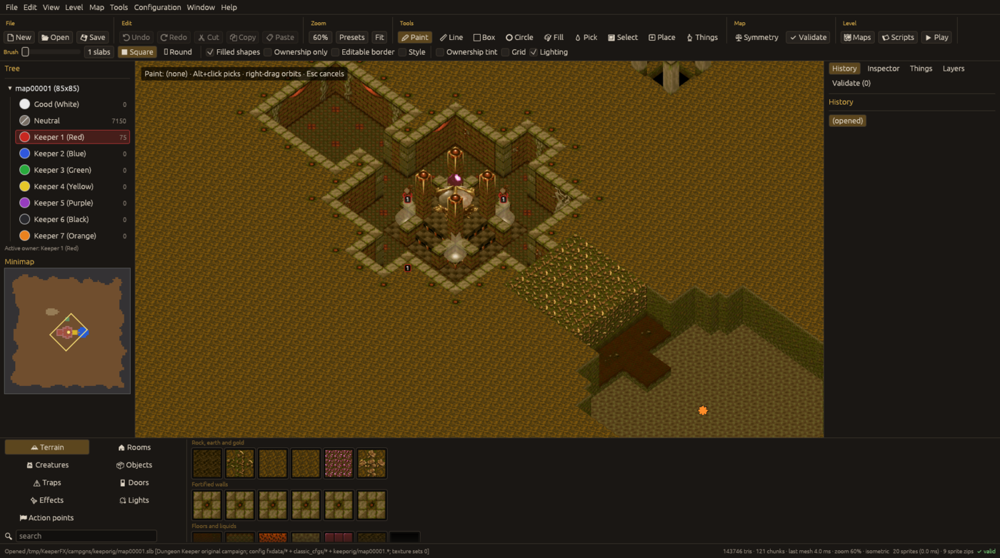
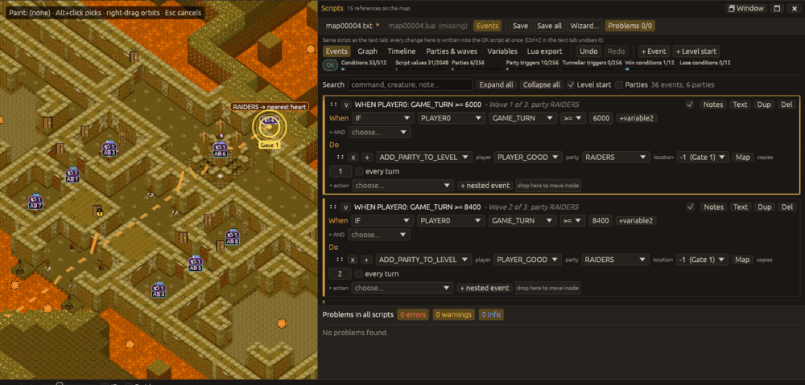
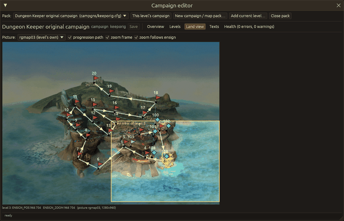

# KeeperFX Map Editor

[](https://github.com/eddoww/keeperfx-editor/actions/workflows/ci.yml)

A map editor for [KeeperFX](https://github.com/dkfans/keeperfx), the open-source engine for
Dungeon Keeper 1. It edits a level as a whole: the terrain (slabs, ownership, columns), the things
on it (creatures, objects, traps, doors, effect generators, hero gates, action points, lights),
the DK level script and the Lua script, and the per-level configuration files the game reads
(`mapNNNNN.rules.cfg`, `mapNNNNN.slabset.toml`, ...). Slabs are placed with the game's own rules,
and maps are saved in the format the game loads. It is written in Rust with egui and wgpu.







## Requirements

* Your own **KeeperFX install** (a folder with `fxdata/` and `data/`, and the original Dungeon
  Keeper data installed into it). The editor ships no game assets: palettes, textures, sprites,
  sounds, configuration and campaigns are read from the install at run time. On first start the
  editor asks for the folder; it can be changed later with `Configuration > KeeperFX folder...`
  or set with the `KFX_INSTALL` environment variable.
* A graphics driver that wgpu can use (on Linux, a Vulkan driver). On Linux both Wayland and X11
  are supported.
* To play-test from the editor: the game executable in the install (`keeperfx` on Linux, or
  `keeperfx.exe`, started through `wine` when not on Windows).

## Download

Builds are published on the [releases page](https://github.com/eddoww/keeperfx-editor/releases)
of this repository (`<tag>` below is the release tag, for example
`v0.1.1`):

| Platform | Archive |
|---|---|
| Linux x86_64 | `kfx-editor-<tag>-linux-x86_64.tar.gz` (also holds a desktop entry and a MIME type file) |
| Windows x86_64 | `kfx-editor-<tag>-windows-x86_64.zip` |
| macOS arm64 / x86_64 | `kfx-editor-<tag>-macos-arm64.tar.gz`, `kfx-editor-<tag>-macos-x86_64.tar.gz` (the executable and an unsigned `KeeperFX Map Editor.app`) |

Each archive contains the executable, this README, the changelog, the licence, `THIRD_PARTY.md`
and the user manual. The Windows and macOS builds are not signed; on macOS, right-click the
application and choose Open the first time.

## Build from source

You need Rust 1.99 or newer (see `rust-version` in `Cargo.toml`). On Linux the build also needs
the development packages for the window system and ALSA; on Debian and Ubuntu:

```sh
sudo apt-get install pkg-config libxkbcommon-dev libwayland-dev libx11-dev libasound2-dev
```

Then:

```sh
cargo build --release -p kfx-editor
target/release/kfx-editor [path/to/map00001.slb]
```

[CONTRIBUTING.md](CONTRIBUTING.md) covers tests, the layout of the code and the generated data.

## Running

```sh
kfx-editor                         # open the window
kfx-editor path/to/map00001.slb    # open a level (any file of the level, or its folder)
kfx-editor validate MAP [--json]   # check a level without opening the window
kfx-editor --help                  # every command and option
```

The command line also has `info`, `script-check`, `export-image`, `regenerate` and `convert`,
and a headless mode that renders the editor offscreen and runs a scripted list of editor actions;
see [Command line](docs/manual/cli.md).

Settings, map backups and crash-recovery snapshots are kept in the platform configuration folder
(`~/.config/kfx-editor` on Linux, `%APPDATA%\KeeperFX\kfx-editor\config` on Windows,
`~/Library/Application Support/net.KeeperFX.kfx-editor` on macOS; `KFX_EDITOR_CONFIG_DIR`
overrides it). In the game folder the editor writes only what you save there (levels, campaigns,
configuration files), the copies of levels it makes in `levels/personal` for play-testing, and
the items you install from the Workshop.

## Features

* Terrain painting with the game's slab placement rules, ownership, custom slabs, resize, flip,
  rotate and mirror symmetry; 3D, 2D and first-person views; named undo and redo.
* Things: placing, selecting and editing creatures, objects, traps, doors, effect generators,
  hero gates, action points and lights.
* DK script and Lua editors with completion, hover documentation and diagnostics, a script
  wizard, and a visual Events editor for waves, parties and triggers.
* Configuration editors that write minimal per-level override files, with mods and layers shown.
* Campaign and map pack editor, prefabs, a translation grid for level texts, a map generator
  and map analysis (reachability, distances, fairness, symmetry).
* Play-testing with the game log, a live link with the running game, sound previews and a
  KeeperFX Workshop window.
* All-or-nothing saves, backups before overwriting and crash recovery.

The full list is in [docs/features.md](docs/features.md), and the
[user manual](docs/manual/README.md) describes each part. Known limitations are listed in
[docs/roadmap.md](docs/roadmap.md).

## Status

Version 0.1.1, a pre-release. The editor is developed and tested on Linux, including tests
that load its maps in the real game. The Windows (x86_64) and macOS (arm64 and x86_64) builds are
compiled and tested in CI; reports from those platforms are welcome.

## Reporting problems

Please use [GitHub issues](https://github.com/eddoww/keeperfx-editor/issues). See
[CONTRIBUTING.md](CONTRIBUTING.md#reporting-bugs) for what to include.

## Licence

GPL-2.0-or-later, see [LICENSE](LICENSE). Dependencies, data provenance and notes for
redistributors are in [THIRD_PARTY.md](THIRD_PARTY.md).

Dungeon Keeper is a trademark of its owners. This project is not affiliated with them.

## Acknowledgements

* The [KeeperFX](https://github.com/dkfans/keeperfx) project: the editor follows the game's
  source code for its file formats and rules, and its command tables, configuration schema and
  Lua API are extracted from that source. Script command documentation comes from the
  [KeeperFX wiki](https://github.com/dkfans/keeperfx/wiki).
* [Unearth](https://github.com/rainlizard/Unearth) by rainlizard, whose `.une` custom slab files
  and `custom_slabs.cfg` the editor can read and keep up to date.
