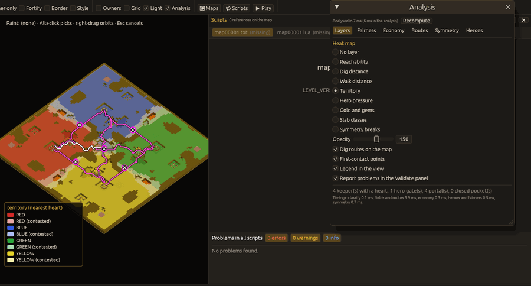
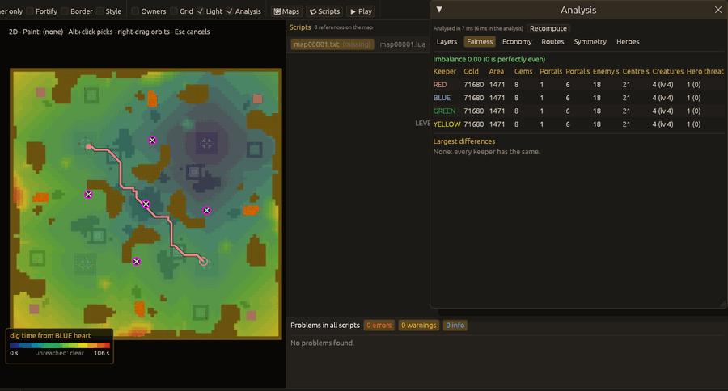

# Map analysis

`View > Analysis` (Ctrl+Shift+A, or the **Analysis** box in the toolbar's Show group) opens the
Analysis window. It answers questions a map maker otherwise checks by playing: can every keeper
reach a portal and gold, how long do imps need to dig to the enemy, is the map fair, is it
symmetric, where do the heroes go. The numbers come from the `kfx-analysis` crate and use the
map's own rules (`rules.cfg`, `terrain.cfg`, `creature.cfg` of the level, its campaign and mods).

## How it runs

The map is analysed on a background thread, so the editor never waits for it: after an edit the
analysis starts again once the map has not changed for 0.4 s (a running brush stroke is waited
for), on a copy of the map. A result that arrives for an older version of the map is thrown
away. The window's first line says how long the last run took and whether a newer one is on its
way; **Recompute** runs it again at once.

Timings on a generated 170x170 map with seven keepers (the largest kind of map): a release build
takes 28 ms for a whole recompute (median of ten runs, including the copy of the map; 21 ms of it
in the analysis), a debug build about 50 ms; an 85x85 map with four keepers takes 5 to 10 ms.
Drawing the heat map adds nothing noticeable to the frame time (3.5 ms per frame at 1600x1000).

## Layers

The **Layers** tab picks one heat map, drawn as translucent tiles on top of the slabs in the 3D
view and in the 2D view (also with flat colours), with a legend in the bottom-left corner of the
view:

| Layer | Shows |
|---|---|
| Reachability | for one keeper: slabs its creatures walk to now, reach after digging, reach only across lava (flying creatures or a bridge), or never |
| Dig distance | seconds for one keeper's imps to reach each slab, digging on the way |
| Walk distance | seconds for one keeper's creatures to walk to each slab without digging |
| Territory | the keeper whose imps reach each slab first; pale where another keeper is almost as close (within 15 %) |
| Hero pressure | seconds for heroes from the nearest hero gate (with a tunneller) to reach each slab |
| Gold and gems | gold and gem slabs in the colour of the keeper that reaches them first |
| Slab classes | rock, earth, gold, gems, wall, floor, room, water, lava, door as the analysis sees them |
| Symmetry breaks | the slabs that differ from their image under the chosen symmetry |

The per-keeper layers have a keeper choice under the list. **Opacity** sets how strongly the heat
map covers the terrain. Unreached slabs of a distance layer stay uncovered. The window must be
open for the layer to show; closing it hides the heat map, routes and markers.

**Dig routes on the map** draws the shortest dig route between every pair of hearts (pink) and
from each hero gate to its nearest heart (white). **First-contact points** marks with a circled
cross where two keepers digging towards each other meet.

## Tabs

* **Fairness** (two or more keepers): a table per keeper (gold reached first, claimable area,
  gem slabs, portals, seconds to the nearest portal, to first contact with the nearest enemy and
  to the map centre, pre-placed creatures, hero threat) and the imbalance score: 0 is perfectly
  even, the weighted spread of the metrics. The largest differences are listed in words.
* **Economy**: gold and gem slabs per keeper (owned = reached first, contested, reachable at
  all), loose gold, claimable slabs, the nearest portal, and the pre-built rooms; click a room to
  locate it.
* **Routes**: every route with its time; click one to highlight only that route and centre the
  views on it, **All routes** shows them all again. The first-contact points are listed below.
* **Symmetry**: how many slabs match for each mode (north-south, east-west, 4-way mirror, half
  turn, quarter turn); pick a mode to see what breaks it. Things without their image (hearts,
  gates, creatures, gold) come first, then groups of differing slabs, largest first. Click an
  entry: both views centre on it, it is selected and flashes.
* **Heroes**: for each hero gate and pre-placed hero group, the keeper it reaches first and in how
  long, walking or with a tunneller; click to locate.

## Findings in the Validate panel

With **Report problems in the Validate panel** on (the default), findings appear in the Validate
tab next to the map checks, with codes starting with `analysis-`. Shipped campaign levels often
do things on purpose that would be a mistake in a skirmish map (a player walled in against
computer keepers, gold that comes from the script, hero gates behind lava), so only an unfair
start on an evenly laid out map is a warning; everything else is a note:

| Code | Severity | When |
|---|---|---|
| `analysis-no-portal` | warning | a keeper's imps cannot reach any portal while another keeper's can, on a map whose layout matches one symmetry for at least 90 % of its slabs |
| `analysis-no-portal` | note | the same on any other map (creatures must come from the script) |
| `analysis-no-gold` | warning / note | a keeper reaches no gold, gems or loose gold; warning under the same condition as above |
| `analysis-portal-across-lava` | note | a keeper reaches a portal only across lava |
| `analysis-gate-isolated` | note | heroes from a hero gate can never walk or tunnel to any keeper's heart |
| `analysis-keepers-apart` | note | two keepers can never reach each other's hearts, not even through walls or by flying |
| `analysis-isolated-things` | note | things in a closed pocket that no keeper or hero reaches |

Over the 274 shipped maps of the test install these rules give no warning (a test checks this).
Asymmetry and an imbalance score are never reported as problems.

## Limits

The analysis works per slab: columns, room furniture and floor height steps inside a slab are
ignored. Times are for one imp; real imps dig in parallel, so absolute times are pessimistic but
compare keepers and maps fairly. Doors, locked doors and enemy walls are taken into account
(enemy walls only for the heart-to-heart route when nothing else connects two hearts).

## Command line

`--actions` (see [Command line](cli.md#analysis-and-generator)): `analysis`, `analysis_layer`,
`analysis_player`, `analysis_route`, `analysis_breaker`, `analysis_print`, `analysis_bench`.
