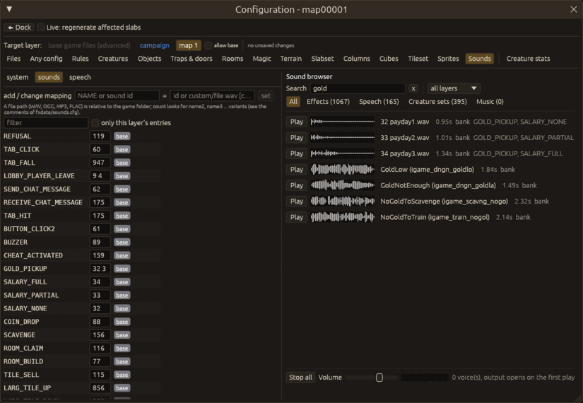

# Sounds

The editor can play the game's sounds the way KeeperFX resolves them for the open level: the sound
banks (`sound/sound.dat`, `sound/speech_<language>.dat`), every `sounds.cfg` layer (base, mods,
campaign, the map's own `mapNNNNN.sounds.cfg`), custom sound files (WAV, MP3, Ogg Vorbis, FLAC),
the creature sound sets of `creatrs/<creature>.cfg`, the level speech of the campaign and the
music tracks.

Nothing is loaded and no audio device is opened when the editor starts. The sounds of the level
are read the first time something asks for one, and the audio output is opened the first time you
press a play button.

## The sound browser

`Configuration > Sounds…` opens the configuration editor on its Sounds tab. The `sounds.cfg`
mappings are on the left (see [Config overrides and mods](config-and-mods.md)); the sound browser
is on the right.

- **Search** matches the name, the aliases (`GOLD_PICKUP`), the file name and the layer.
- The category buttons show effects, speech messages, creature sound sets or music; the layer list
  shows only the sounds a given layer defines (bank, install, a mod, the campaign, the level).
- **Play** plays a sound; a sound with several variants (`count` in the configuration) plays the
  next variant each time, like the game picks one of them. **Stop all** and the volume slider act on
  the previews only. Each row shows a small waveform, the length and the layer that supplied it.
- **Use** (or a double click) puts the selected sound into the "add / change mapping" value: `id
  count` for a range of `sound.dat`, or the file name of a custom sound.

The browser shows what is saved: unsaved edits of `sounds.cfg` are not played until they are
saved.

## Creature sounds

In the configuration editor's Creatures tab, the **Sounds** page of a creature shows its `[sounds]`
slots (`Foot`, `Hit`, `Happy`, ...) and below them the browser, filtered to that creature. Choose a
slot in **assign to**, select another sound (for example in the Effects category) and press
**Use**: the slot gets that sound's `id count` (an unsaved edit of the creature file at the target
layer).

## Level speech

`Level > Level properties…` has **Preview level speech (intro)** and **Outro** under the speech
names. They play the file from the campaign's `[speech]` folder for the editor's language, as the
land view does (`.wav` is added when the name has no extension). A level outside a campaign has no
speech folder; the dialog says so.

## Scripts

In the DK script editor, hover the sound argument of `PLAY_MESSAGE(player, SPEECH, n)`,
`PLAY_MESSAGE(player, SOUND, n)` (a number, a sound name or a file name) or `SET_MUSIC(track)`: the
card says what the game plays (bank sample, custom file, the layer that defined it, the number of
variants) and has a **Play** button. These commands are KeeperFX commands: the script needs
`LEVEL_VERSION(1)` for the game (and the editor) to read them. Lua scripts have no sound hover.

## Muting

`Preferences > Play > Mute the editor's sound previews` keeps every preview silent; the audio
device is then never opened. The same page shows which output is in use.

## Limits

- Previews play through the system's default output (ALSA / PulseAudio on Linux, WASAPI on
  Windows, CoreAudio on macOS). If no output can be opened the editor plays into a silent
  ("null") output and the browser's footer says so.
- The game's 3D positioning, the sound "stack" mixing modes and the music streaming of the game are
  not reproduced: a preview is the sample itself.

## Command line (`--actions`)

- `{"sounds": {"tab": "sounds" | "creature", "creature": "IMP", "filter": "gold", "category":
  "effects" | "speech" | "creatures" | "music", "play": "fx:32"}}`: opens the configuration editor
  on its Sounds tab (or a creature's Sounds page) and sets the browser; `play` plays an entry (the
  headless mode always uses the silent output).
- `{"mute": true}`: the mute preference.
- `{"speech_preview": "intro" | "outro" | "<file>"}`: the speech preview of Level properties.
