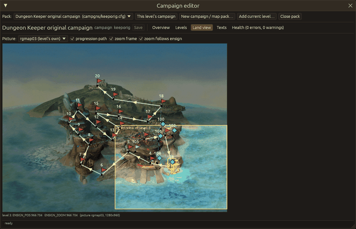

# Campaigns and map packs

The campaign editor edits a campaign (`campgns/<name>.cfg`) or a map pack
(`levels/<name>.cfg`, `multiplayer/<name>.cfg`) of the install: its settings, its level list,
the land view with the ensigns, the text tables and a list of problems with fixes.



## Opening it

* `Campaign > Campaign editor…` (**Ctrl+Shift+K**) shows the window. It reopens the campaign
  you had open last; the window's open state is kept with the window layout.
* `Campaign > Campaign of this level…`, or the "This level's campaign" button in the window,
  opens the campaign or map pack the open map belongs to.
* `Campaign > Open campaign or map pack` and the "Pack" list at the top of the window list every
  campaign and map pack of the install.
* In the map browser (`File > Map browser…`), select a pack and press "Edit this campaign" (or
  "Edit this map pack").

When the open pack has unsaved changes and you choose another one, the window asks whether to
save or discard them first. Closing the editor with unsaved campaign changes asks too.

## The tabs

* **Overview**: every `[common]` key (name, folders, media, players, land view settings) and
  "Package as zip".
* **Levels**: the level list by kind (single, bonus, extra; free and multiplayer for map packs).
  Drag the `::` handle to reorder the single or extra levels, link a bonus level to the single
  level that reveals it, add a level of another pack ("Add existing level…") or remove one. The
  form on the right edits the level's `[mapNNNNN]` block (map packs: its `.lof`).
  "Open in editor" opens the level in the map editor (with the usual question when the open map
  has unsaved changes); "Play" plays it with the editor's play settings (save the campaign first:
  the game reads the campaign file from disk).
* **Land view**: the land view picture as the game draws it, one ensign per level. Drag an
  ensign to set its `ENSIGN_POS`; the zoom point (`ENSIGN_ZOOM`, the yellow cross of the
  selected level) follows while "Zoom follows ensign" is on and it was on the ensign. The yellow
  frame is what the game zooms into, the white arrows the order of the single levels, dashed
  lines the bonus links.
* **Texts**: the `[strings]` tables side by side; missing translations are marked.
* **Health**: problems with the rule they come from and a "Fix" button where there is a safe fix.

"Save" writes the campaign file (and edited text tables). Nothing else is written until you
save, except adding or removing level files, which happens at once.

## A new campaign or map pack

`Campaign > New campaign / map pack…` (or the button in the window) opens the wizard:

* **Kind**: campaign (`campgns/`), map pack (`levels/`) or multiplayer pack (`multiplayer/`).
* **Name in the menu** (`NAME`) and **file name** (letters, digits, `_` and `-`, up to 40
  characters; also the start of the pack's folder names). The wizard says why a name is refused
  and refuses a pack that exists.
* **Land view**: a campaign of the install whose land view pictures are copied into the new
  campaign's `<name>_lnd` folder (a map pack refers to it instead), or none.
* **Languages**: English is always made; tick others to get their text tables.
* **First level**: add the open map (as saved) as the first level.

It makes `<name>.cfg`, the levels folder with empty text tables, and for a campaign the land view
and speech folders, then opens the pack in the campaign editor.

## Adding the open map

`Campaign > Add current level to campaign…` (or "Add current level…" in the window) adds the
saved files of the open map to the pack open in the campaign editor, as a single, bonus or extra
level (map packs: free, single, multiplayer, bonus or extra). A map that is already in the pack's
levels folder keeps its number; one from elsewhere is copied in with the next free number (its
scripts, config overrides, string tables and editor data file go along). Save the map first. The
campaign file changes in the editor; press "Save" to write it.

## Command line

The headless mode (`--actions`, see [Command line](cli.md)) knows:

```json
[
 {"campaign": {"open": "campgns/keeporig.cfg", "tab": "land", "select": 3}},
 {"campaign": {"ensign": [3, 700, 500]}},
 {"campaign": {"ensign_by": [3, 40, -20], "save": false}},
 {"campaign": {"open": "own"}},
 {"campaign": {"add_current": "single", "close": true}},
 {"campaign_wizard": {"name": "mycamp", "display_name": "My campaign", "kind": "campaign",
                      "land_from": "keeporig", "languages": ["FRE"], "add_current": false,
                      "install": "/path/to/a/copy/of/an/install", "create": true}}
]
```

`open` takes a `.cfg` path (relative to the actions file or to the install), `"own"` (the open
map's pack) or `true` / `false` (show / hide the window). `tab` is `overview`, `levels`, `land`,
`texts` or `health`. `ensign` sets a level's position like a drag, `ensign_by` moves it by an
offset in picture pixels. `save` writes the campaign file. Without `"create": true` the wizard is
only filled in (for a screenshot).
