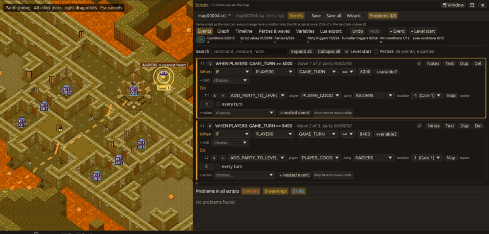
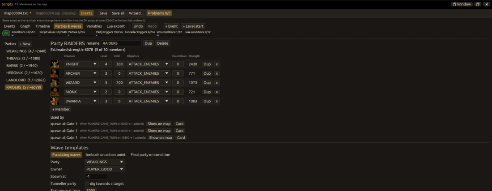

# Events editor

The **Events** tab of the script panel shows the level's DK script (`mapNNNNN.txt`) as events:
a trigger (conditions) and what happens (actions), plus the parties the script spawns. It is the
same script as the text tab, not a copy: whatever you change on one side is in the other.

Open it with `View > Events editor` or `Level > Events…`, **Ctrl+F3**, or the **Events** tab of
the script panel (F3 opens the panel). **Ctrl+F3** again goes back to the text. The panel can be
docked, maximised over the map (F4) or in its own window like the text editor; the view you
used last and whether the Events tab was open are remembered with the layout.

## Views

The row under the tabs picks the view:

* **Events**: one card per event. "When" lists the conditions (several are combined with AND),
  "Do" the actions with their arguments as fields and drop-down lists. Cards can be dragged,
  duplicated, disabled, nested, given notes. **Text** on a card opens the text tab at its line.
  Groups of commands that run when the level loads are collapsed "LEVEL START" cards.
* **Graph**: events as boxes, wires where one event sets a flag another one tests. Dragging from
  an event's right port onto another event chains them with a new flag.
* **Timeline**: events gated by a game turn or timer on a time axis; drag a marker to retime it.
* **Parties & waves**: the party designer and the wave templates (below).
* **Variables**: flags, timers and campaign flags, their aliases and which events read or write
  them.
* **Lua export**: the same logic as a Lua level script, with what has no Lua equivalent flagged.

The toolbar has the Events undo / redo, **+ Event** (a new event with a condition) and
**+ Level start** (commands run when the level loads). The badge and meters show the validation
of the script and how much of the game's script limits it uses.

## Parties and waves

The party list shows each party's size and estimated strength. A party's members have the game's
creature portraits (the icons the editor's thing palette shows); **Strength** is the game's
creature score at that experience level (`compute_creature_kind_score`: health, defence,
dexterity, armour and strength grown by the `[experience]` rates of `creature.cfg`), read from
the creature configs of the open level, so a campaign's or the map's own creature files count.

"Used by" lists the actions that bring the party into the level; **Show on map** draws its route.

**Wave templates** write ordinary events:

* **Escalating waves**: N waves of a party from a game turn, every M turns, each with more copies;
  optionally a tunneller party digging towards a target.
* **Ambush on action point**: the party appears when a player reaches an action point, with an
  optional message.
* **Final party on condition**: the party appears when a flag or other variable reaches a value.

## On the map

* Selecting an event rings the places it uses (action points, hero gates, hearts, subtiles) on
  the map and flashes the first one.
* A party spawned by the selected event (or shown with **Show on map**) gets a route: an orange
  line from where it appears to where it heads. A tunneller party's line ends at its target; for
  a normal party the line is dashed and ends at the nearest keeper heart (heroes go for the
  keepers; the real path depends on the map and the members' objectives). The routes are drawn
  in the 3D and the 2D view.
* **Map** next to a location, action point or coordinate argument picks it on the map: click an
  action point or hero gate icon (or a subtile / slab); Esc cancels.
* **Str** next to a message number opens a string picker: the texts the game shows for the ids
  (the level's, the campaign's, then the game's own), searchable by id or text; **New level
  string** makes a new string of the level (type its text in the Strings window).

## One script, two views

* The text is what is saved. The Events view is rebuilt from the text whenever the text changed
  (typing, text undo, the wizard, renumbering), so it is never stale.
* Each change in the Events tab is written into the text at once as one replacement of the
  changed lines. The text tab's undo (Ctrl+Z in the text) undoes it like any other edit; the
  Events view follows.
* The Events undo (toolbar, or Ctrl+Z / Ctrl+Y with the pointer over the Events tab) steps back
  through the Events changes since the view was last rebuilt from the text, and writes the result
  into the text.
* Scripts the Events editor cannot represent faithfully (for example an `IF` never closed) are
  shown **view only** with a banner saying why; edit them in the text tab. The text is never
  rewritten by the Events view in that case.
* Comments and the layout of lines you did not touch are kept byte for byte.

The Lua script is not shown in the Events tab.

## Headless

The `--actions` keys `events`, `events_view`, `events_select`, `events_party`, `events_add_wave`,
`events_undo`, `events_redo` and `events_print` drive the Events editor without a window, see
[Command line](cli.md#events-editor-actions).
