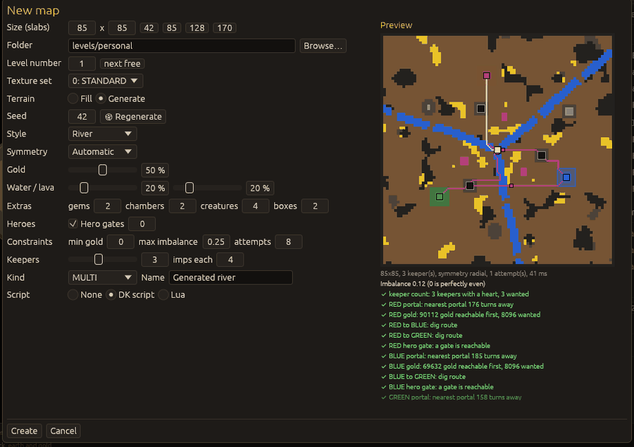

# Map generator

## New map: Generate

`File > New map...` (Ctrl+N) has two ways to make the terrain. **Fill** makes a plain map
(one slab kind, keepers placed on a ring, see
[Getting started](getting-started.md#a-new-map)). **Generate** makes a random map that is checked
before you get it: every keeper has a heart in a claimed start area, a portal its imps can reach
by digging, enough gold that it reaches before anyone else, a dig route to every other keeper and,
with heroes, to a hero gate; with two or more keepers the fairness imbalance must be at most the
chosen maximum, and the map must pass validation without errors. A map that fails is repaired
(corridors dug, gold added) or rolled again, up to the number of attempts.

Options:

* **Seed**: the same seed and options give the same map on every computer. **🎲 Regenerate**
  picks a new seed.
* **Style**: Open cave (earth with rock outcrops, gold veins, pools and caverns), Chambers
  (rock with pre-dug chambers joined by corridors), Islands (keepers on islands in a lava or water
  sea, joined by earth causeways), River (rivers of lava or water between the keepers, with
  fords), Fortress (a walled hero stronghold in the centre).
* **Symmetry**: Automatic (half turn for 2 keepers, quarter turn or 4-way for 4, radial for
  other counts), None, Radial (keepers rotated by equal angles; close to, not exactly, symmetric),
  or an exact mode (north-south, east-west, 4-way, half turn, quarter turn; the keeper count must
  be a multiple of the mode's size).
* **Gold**, **Water / lava**: amounts in percent.
* **Extras**: gem clusters, neutral chambers (every other one with a neutral room), neutral
  creatures and special boxes spread over the chambers.
* **Heroes**: hero gates (0: one set around the map centre).
* **Constraints**: minimum gold per keeper (0: from the gold amount), the largest fairness
  imbalance accepted, attempts.
* **Keepers** (0 to 7) and imps each; the size is 20 to 170 slabs each way.

The preview on the right is generated in the background a quarter of a second after the options
stop changing: the terrain, the dig routes between the hearts (pink) and to the hero gate
(white), hearts in the keeper colours, portals and gates. Under it is the constraints report:
the symmetry used, attempts, time, the imbalance, every check with ✔ or ✖, repairs made and
notes. When no attempt meets every constraint the report says why; try another seed, fewer
keepers, more gold or more attempts.

**Create** uses the previewed map when its options are unchanged, else generates it then. The
starter script (DK script or Lua) sets the generation speed, money and creature limit of each
keeper, computer players for every keeper but the first, the creature pool, rooms and powers,
and win / lose conditions. The level kind and name are written to the `.lof` with the first save,
as for filled maps.

## Generate into selection

`Map > Generate into selection...` (Ctrl+Shift+G, needs a rectangle selected with the Select
tool, at least 8x8 slabs) fills the selection with generated terrain: style, seed, keepers inside
the rectangle (0 for terrain only), gold, water and lava, chambers, creatures, boxes and hero
gates. Things standing in the rectangle are removed first. The change is **one undo step**, and
it is refused when it would add validation errors to the map.

## Command line

A level can be generated without the window: see [Command line](cli.md#analysis-and-generator).
