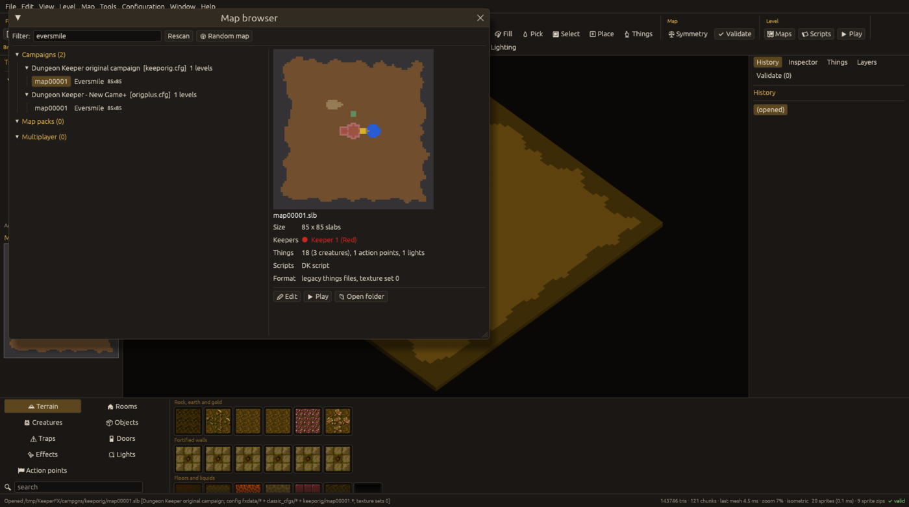
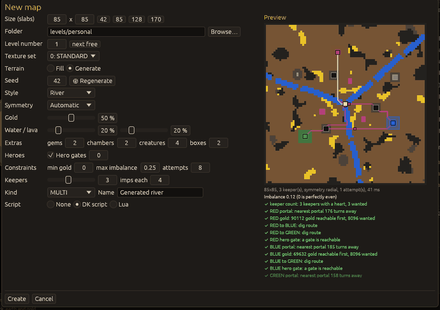
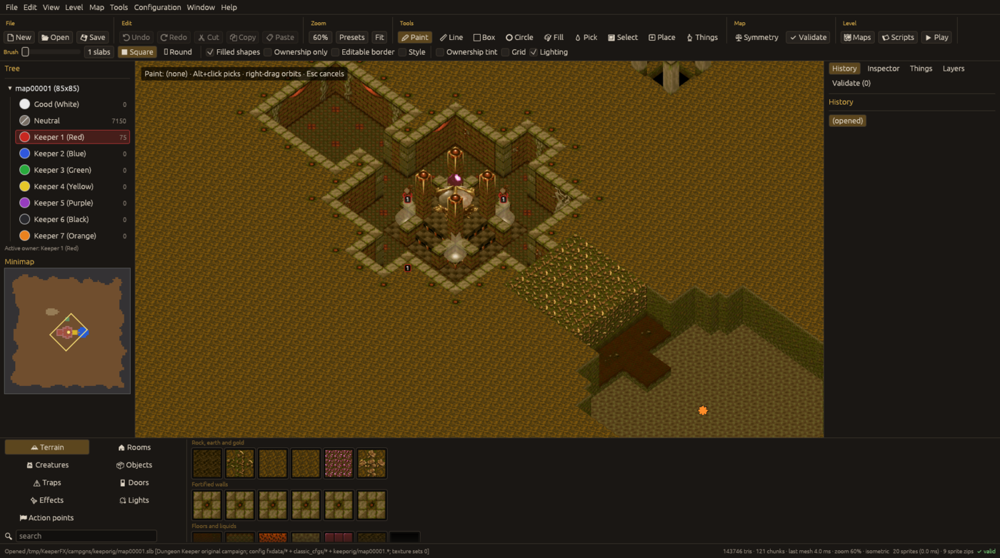

# Getting started and first run

## What you need

A KeeperFX install: a folder that contains `fxdata/` and `data/` (any letter case). The editor
ships no game assets; it reads palettes, textures, sprites, configs and campaigns from that folder.

## Installing

Download the editor from the [releases page](https://github.com/eddoww/keeperfx-editor/releases)
(`<tag>` is the version, for example `v0.1.2`).

**Windows.** Two choices:

* `kfx-editor-<tag>-windows-x86_64-setup.exe`, the installer (recommended). It installs for your
  user account, without administrator rights, into
  `%LOCALAPPDATA%\Programs\KeeperFX Map Editor`, adds a Start menu entry and optionally a desktop
  shortcut and an "Open with KeeperFX Map Editor" entry for `.slb` map files. Running a newer
  installer over it upgrades in place. The setup can also install for all users (into Program
  Files, with administrator rights).
* `kfx-editor-<tag>-windows-x86_64.zip`, the portable version: unpack it anywhere you can write
  and start `kfx-editor.exe`.

Both hold `kfx-editor.exe`, the editor window (it opens no console window), and
`kfx-editor-cli.exe`, the same program for the [command line](cli.md). They are not code-signed,
so the first start shows a Windows SmartScreen warning, "Windows protected your PC": choose
**More info**, then **Run anyway**. The editor cannot avoid this warning without a paid
code-signing certificate.

Silent installation (for scripts): `kfx-editor-<tag>-windows-x86_64-setup.exe /VERYSILENT
/SUPPRESSMSGBOXES /NORESTART`, with `/DIR="x:\folder"` for another folder, `/ALLUSERS` for all
users and `/TASKS="desktopicon,slbassoc"` for the optional shortcut and file association.

**macOS.** Unpack `kfx-editor-<tag>-macos-arm64.tar.gz` (Apple silicon) or `-macos-x86_64.tar.gz`
(Intel) and move `KeeperFX Map Editor.app` into Applications (or another folder of yours: the
editor can only update itself from a folder you can write, not from Downloads). The application
is not signed, so the first time right-click (or Control-click) it and choose **Open**, then
**Open** again.

**Linux.** Unpack `kfx-editor-<tag>-linux-x86_64.tar.gz` anywhere you can write and run
`kfx-editor`. The archive also holds a desktop entry, a MIME type file for map files and icons
(`icons/hicolor`) to copy into `~/.local/share/applications`, `~/.local/share/mime/packages` and
`~/.local/share/icons`. An Arch Linux package can be built from `packaging/PKGBUILD`.

## First run

If no valid install is known, the **KeeperFX folder** dialog opens: type or browse to the folder.
It says "Looks like a KeeperFX install." when `fxdata/` and `data/` are found, and only then
enables **Use this folder**. The choice is saved in the settings. Later you can change it with
`Configuration > KeeperFX folder...` or Preferences > Files. The environment variable
`KFX_INSTALL` overrides the saved folder (it is not saved). If you open a map that lives inside an
install (for example from the command line), that install is found by walking up the folders.

Settings, backups and crash-recovery autosaves are stored in the editor's config folder (shown at
the bottom of Preferences > Files; `KFX_EDITOR_CONFIG_DIR` overrides it).

Right after that, a notice asks whether the editor may look for new versions: once a day it would
ask GitHub for the list of releases. Nothing is sent before you answer. **Check for updates once a
day** turns the checks on, **Turn update checks off** turns them off; both can be changed later in
Preferences > Updates. See [Updates](updates.md).

## Where things are

* The program: where you unpacked it, or the folder chosen in the installer (by default
  `%LOCALAPPDATA%\Programs\KeeperFX Map Editor` on Windows).
* Settings, backups, crash-recovery snapshots, the update state and crash logs: the configuration
  folder, `~/.config/kfx-editor` on Linux, `%APPDATA%\KeeperFX\kfx-editor\config` on Windows,
  `~/Library/Application Support/net.KeeperFX.kfx-editor` on macOS.
* Maps: wherever you save them; in the KeeperFX folder the editor writes only what you save there,
  play-test copies in `levels/personal` and Workshop items you install.

## Updates

New versions are announced in the window (if update checks are on) and installed with
**Update now** in Help > Check for updates..., which keeps your open map. See [Updates](updates.md),
also for turning the checks off.

## Uninstalling

* **Windows, installed with the setup program**: Settings > Apps > Installed apps (or Apps &
  features), "KeeperFX Map Editor", Uninstall. Silently: `unins000.exe /VERYSILENT` in the
  install folder.
* **Zip, macOS, Linux archive**: delete the folder (or the `.app`).
* The configuration folder above is not removed by either; delete it too to remove settings,
  backups and logs. Maps you saved stay where they are.

## Opening a map

* `File > Open...` (Ctrl+O): pick a `mapNNNNN.slb` (or any file of the level).
* `File > Map browser...` (Ctrl+B): the install's campaigns, map packs and multiplayer packs as a
  tree with level names, a filter box, a thumbnail with facts (size, keepers, thing counts,
  scripts, file format) and **Edit**, **Play**, **Open folder** buttons, a **Random map** button and
  a **Rescan** button.
* Drag a map file or a folder onto the window (a folder opens its lowest numbered map).
* The first command-line argument: `kfx-editor path/to/map00001.slb`.
* `File > Recent maps` keeps the last 10, with the level name when known.

Opening a map with unsaved changes asks first. File names are matched case-insensitively
(`MAP00007.SLB` and `map00001.slb` both work).

## A new map

`File > New map...` (Ctrl+N) opens the generator with a live preview:

* size in slabs (1 to 170 each way; shortcuts for 42, 85, 128, 170), folder (default
  `levels/personal` of the install), level number (**next free** button), texture set;
* **Fill**: border (impenetrable rock or none) and the fill slab, symmetry of the keeper
  placement (none, N-S, E-W, 4-way, rotational 2, rotational 4); or **Generate**: a seeded,
  constrained random map in one of five styles (see [Map generator](generator.md));
* keepers (0 to 7) each with a dungeon heart in a small claimed area, imps per keeper, a portal and
  gold near each heart, hero gates;
* a starter script: none, DK script or Lua.

New maps are created in the KeeperFX file format (see [file formats](../formats.md)).

## The window

* **Menu bar**: File, Edit, View, Level, Map, Tools, Configuration, Window, Help.
* **Toolbar**: file, edit (undo, redo, cut, copy, paste), zoom, tools, symmetry and validate,
  and level buttons (Maps, Scripts, Play). The second row holds the brush size and shape and the
  tool options.
* **Left panel**: the tree of the level with the owners and the number of slabs each owns (the
  active owner is highlighted), the minimap, and the tabs History, Inspector, Things, Layers,
  Validate, Notes and Files. With `View > Panels as tabs beside the tree` switched off, the tabs
  are in a right panel instead, as in the pictures of this manual.
* **Viewport** in the middle.
* **Bottom palette**: Terrain, Rooms, Creatures, Objects, Traps, Doors, Effects, Lights, Action
  points, with a search box.
* **Status bar**: what was opened and which config layers apply, mesh statistics, zoom, and a
  validity indicator.

## Saving

`Ctrl+S` saves the map **and** the scripts. `Save as...` asks for a folder and level number and
warns before overwriting. See [level properties and files](level-properties.md) for what is written.

How a save protects your files:

* **All or nothing.** The map's files are first written next to the old ones under temporary
  names; only when every one is complete are the old files replaced, and if anything fails (disk
  full, no permission, a file marked read-only) the old files are put back. The map on disk is
  then exactly the old one or exactly the new one, never half of each. Other files the editor
  writes (string tables, `.lof`, scripts, configuration overrides, settings) are replaced the same
  way, one at a time.
* **Backups before the first overwrite.** The first time a session overwrites or deletes a file of
  the level (map files, scripts, `.lof` / `.lif`, string tables, configuration overrides) or of its
  campaign (the campaign `.cfg`, its string tables), the old file is copied to the backups folder
  first. If that copy fails, nothing is written and the status bar says why. `File > Backups...`
  lists the level backups, restores them and prunes by size; the copies of single files are in
  folders named `<time>-files` (with `SOURCE.txt` saying where each came from) and `<time>-config`.
* **Crash recovery.** While changes are unsaved a crash-recovery snapshot is written every N
  seconds (Preferences > Files). It is deleted only after a save that wrote everything it holds.
* **Unreadable files are never overwritten silently**: see
  [Troubleshooting](troubleshooting.md#some-files-of-this-map-could-not-be-read).
* **Levels the game would refuse are not written**: a thing the game cannot create from a
  `.tngfx` (for example a Shot, or an unknown `SubtypeStringID`) makes the game refuse the whole
  level, so the save is refused with the list of such things; fix or remove them (the validator
  lists them as errors).
