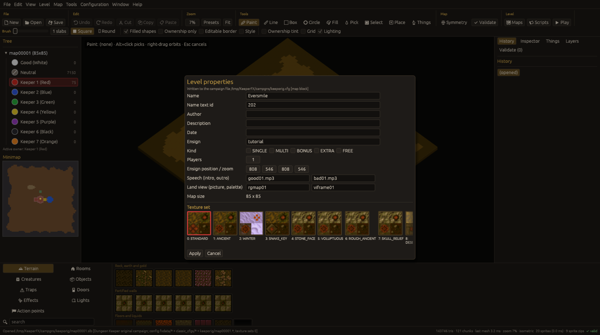

# Level properties and the files written

`Level > Level properties...`

Name, name text id, author, description, date, ensign, kind (single, multi, bonus, extra, free),
number of players, ensign position and zoom, speech files (intro, outro), land view (picture,
palette), the map size (read-only here, use Map > Resize), and the texture set with thumbnails.
For a level of a **campaign** the values are written into the campaign `.cfg`'s `[mapNNNNN]`
block (the dialog names the file); otherwise into the level's `.lof`.

## Files written on save

`.slb .own .wlb .inf .wib .clm .dat`, `.slx` only if used, `.flg` only if the map had one, always
`.tngfx .aptfx .lgtfx` (things, action points, lights; the presence of `.lgtfx` is what makes the
game use them), then stale legacy `.tng .apt .lgt` are removed. Scripts `.txt` / `.lua` are
written when changed. The editor data file `mapNNNNN.kfxed.toml` holds editor-only data when there is any.
Non-85x85 maps get a `.lof` with `MAPSIZE` when the folder has none. The byte layout of every file
is in [file formats](../formats.md).

`File > Save format` chooses between the KeeperFX files (`.tngfx .aptfx .lgtfx`) and the original
Dungeon Keeper files (`.tng .apt .lgt`) for the open map; the choice is stored with the map. Before
every save the map is checked against the chosen format: what the format cannot hold is listed,
and errors block the save. From the command line, `kfx-editor convert MAP --to fx|legacy` does the
same.
Save As copies the level's extra files (config overrides, string tables, custom sprites, `.lof`,
`.lif`).
