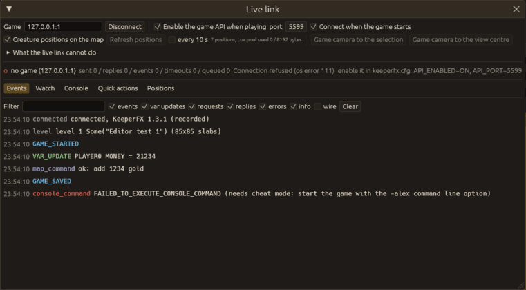
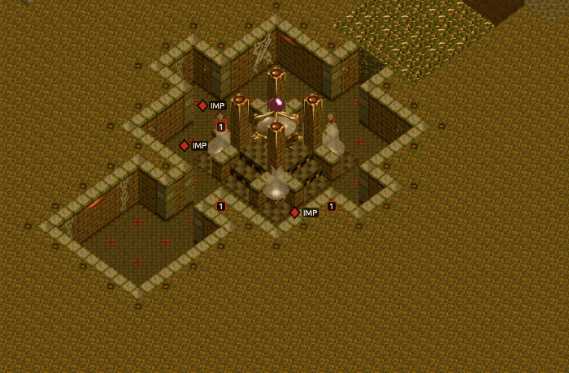

# Live link

While you play-test, the editor can talk to the running game through the game's own API (a TCP
connection with JSON messages, built into KeeperFX). The **Live link** panel shows the game's
events, watches script flags, timers and variables, sends console and script commands, and draws
where the creatures are on the map.

Open it with `Level > Live link`, `Window > Live link` or **F7**.



## Turning the API on

The game's API is off unless `keeperfx.cfg` has `API_ENABLED=ON` (and `API_PORT`, 5599 by default).
The editor does not change your `keeperfx.cfg`: with **Enable the game API when playing** (in the
panel, or `Preferences > Play`), Play (**F5**) and Save and play (**Shift+F5**) add

```text
-cfg API_ENABLED=ON -cfg API_PORT=<port>
```

to the game's command line. KeeperFX reads `-cfg` lines after `keeperfx.cfg` and the mods'
copies of it, so they apply to that game only. Older KeeperFX builds do
not know `-cfg`: they show "Incorrect command line parameters" and quit. With such a game, turn
the option off and set the two keys in `keeperfx.cfg` yourself.

With **Connect when the game starts** (on by default) the panel connects as soon as the game
answers, and follows the game's `keeperfx.log` for the positions. You can also type an address
(`127.0.0.1:5599`) and press **Connect** to reach a game you started yourself.

## What the panel does

- **Events**: what the game reports (game started / saved / loaded, win, lose, research and
  manufacture completed, specials, action points triggered), variable changes, the requests the
  editor sent and the answers, with a filter.
- **Watch**: add `FLAG0`, `TIMER3`, `MONEY`, a creature name ... for a player; the value updates
  when the game reports a change. `MONEY`, `FLAG0` and `TOTAL_CREATURES` of PLAYER0 are watched
  when you connect.
- **Console**: a game console command, a DK script line, or Lua (prefix `!`, `>` or `=`), with
  history.
- **Quick actions**: add gold, reveal the map, give a room or a power, add a creature at the
  heart, game speed, save / load a game slot.
- **Positions** and **Creature positions on the map**: **Refresh positions** asks the game (through
  Lua) to print every creature's position into its log; the editor reads it and draws a diamond in
  the owner's colour, with the creature's name when zoomed in. **every 10 s** repeats it.
- **Game camera to the selection**: moves the game's camera to the action point or hero gate
  selected in the editor (or to your heart when nothing is selected). This works without cheats.
  **Game camera to the view centre** moves it to the subtile at the centre of the editor's view,
  which needs cheat mode (`-alex`, `Preferences > Play > Cheats`).



## What it cannot do

The panel lists these under **What the live link cannot do**:

- An edited script cannot be pushed into a running game: the API runs one script line at a time
  and has no reload. Save and restart the level to run a changed `mapNNNNN.txt`.
- The game camera goes to action points, hero gates and hearts without cheats; any other place
  needs the game started with `-alex`.
- The API refuses commands while the game is paused, so it cannot unpause it.
- Only flags and a few counters can be written; other script variables are read-only.
- Positions come from Lua printing into `keeperfx.log`. Running Lua through a script command
  uses the level's script string space (8192 bytes): about 200 bytes for the first refresh (a helper
  function is defined once) and about 25 for each later one. Automatic refresh
  stops when 6000 bytes are used. With cheats on, Lua can run through the console instead (the
  "Lua via console" box in the Console tab), which costs nothing.
- The game listens on `127.0.0.1` only, and for one client at a time.

## Command line

`--actions` (see [Command line](cli.md)) knows `{"live": {"open": true, "connect":
"127.0.0.1:5599", "tab": "watch", "api_on_play": true, "port": 5599, "overlay": true}}`,
`{"live_demo": true}` (fills the panel with a recorded session, for documentation pictures) and
`{"print_audiolive": true}`.
