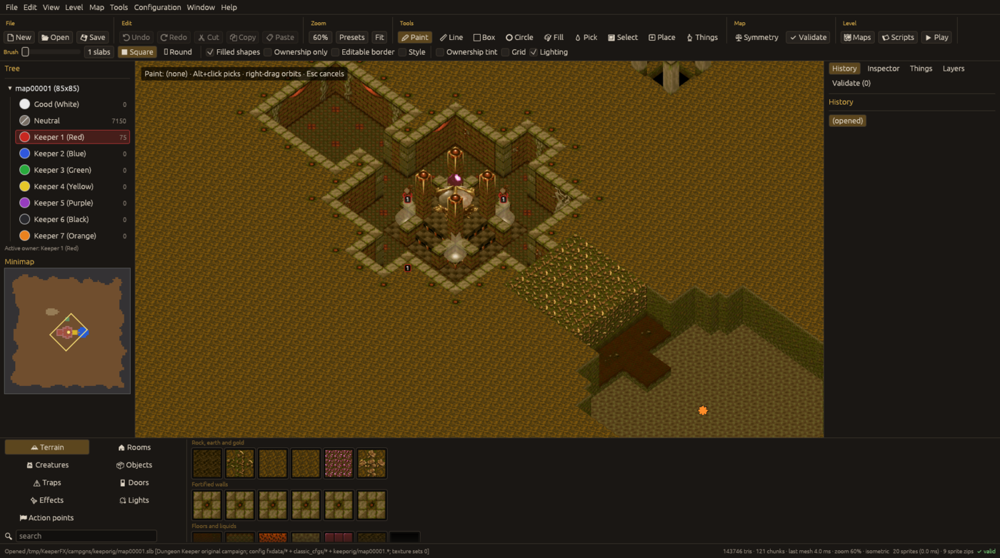

# Navigating the view

The viewport shows the map in the game's isometric view by default (View > Perspective switches to
a perspective camera).

| Input | Effect |
|---|---|
| Wheel | zoom towards the cursor |
| W A S D, arrow keys | pan |
| Middle drag, or Shift + left drag | pan |
| Right drag | orbit |
| Q / E | rotate 45 degrees left / right |
| Home | reset to the game's default view |
| Toolbar **Zoom** | percentage box (25% to 400% presets), **Fit** shows the whole map |

Pan speed, zoom speed, orbit speed, inverted axes, edge panning and smoothing are in Preferences >
Camera. Preferences > Graphics holds the antialiasing setting. The keys can be changed (see
[shortcuts](shortcuts.md)).

## What is drawn

* `View` menu: **Ownership tint**, **Slab grid**, **Lighting**, **Minimap**, and the right panel.
* `View > Layers` toggles: terrain, creatures, objects, traps, doors, effects, slab things (torches,
  room furniture), action points, lights, ranges, owner tint, level badges, gate numbers, script
  markers, animate.
* The pointer shows a readout of the slab under it: slab coordinates, slab kind id and name,
  owner, the subtile, its height and the cube ids.
* Script markers on the map show where the script refers to action points, hero gates and
  locations; hovering shows the script line and clicking jumps to it.

The animation of sprites and textures follows the game's animation frames.

## 2D and split view

`View > 2D view (top-down)` (F2 toggles between 2D and 3D) shows the map from above with its
textures; `View > 2D: flat slab / owner colours` draws plain colours instead.
`View > Split view (2D + 3D)` (Shift+F2) shows both side by side. The tools work in every view.

## Fly view

View > First-person fly view (V, or the toolbar's Fly) puts the camera at eye height over the
map. WASD or the arrow keys move, Q and E go down and up, Shift moves three times faster and the
mouse wheel moves forward. Right-drag looks around; M captures the mouse for mouse-look (a cross
marks the middle of the view, where the tools then act) and M or Esc frees it. V leaves the fly
view. With View > Fly view collision (on by default) the eye stops at walls and stays above the
floor. Speed: Preferences > Camera.

## Grid data

View > Grid data writes one of the map's raw grids over the view: the slab kind id, owner,
`.wlb`, `.slx` texture style or custom slab ID per slab, or the saved `.dat` column index,
wibble, floor height or `.flg` flags per subtile. The numbers appear when zoomed in far enough to
read them.

## Minimap

The minimap outlines what each visible view shows: yellow for the 3D view, blue for the 2D view
(both in the split view). Clicking it moves the views that are shown.

## Layout

By default the player tree and the other panels (History, Inspector, Things, Layers, Validate,
Notes, Files) are tabs of the left panel, the slab and thing palette is at the bottom and the
toolbar groups its buttons under labels, wrapping (and showing icons only) on narrow windows.
Switching off View > Panels as tabs beside the tree moves the tabs to a right panel. Docked panels keep the
map at least 420 points wide; panel widths and window positions are remembered.
