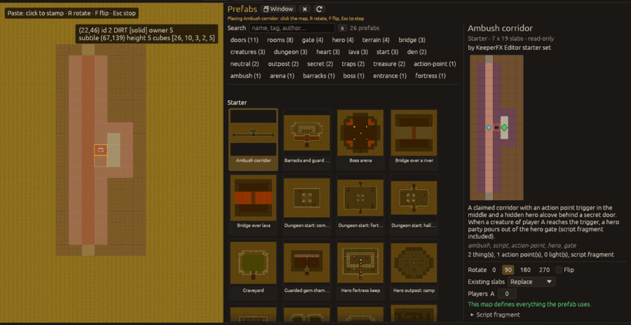

# Prefabs

A prefab is a piece of map kept for placing again: slabs with their owners, the things, action
points and lights on them, and optionally a script fragment that uses the prefab's own action
points and hero gates. Prefab files (`*.kfxprefab`) are plain text; the format is described in
the `kfx-prefab` crate.

## The Prefabs panel

`Window > Prefabs` or `Ctrl+Shift+P` shows the panel beside the map; `Window` in its header gives
it its own window and `Dock` puts it back. Whether it is open, docked and how wide is remembered
between sessions.

The cards come from three libraries:

* **Starter**: 26 prefabs that ship with the editor (dungeon starts, rooms, hero outposts, bridges,
  traps, an ambush with a script). Read-only.
* **User**: your own, in `prefabs/` of the editor's settings folder (`~/.config/kfx-editor/prefabs`
  on Linux, `%APPDATA%\KeeperFX\kfx-editor\config\prefabs` on Windows; the folder is shown under
  Preferences > Files).
* **Campaign**: `prefabs/` in the levels folder of the open level's campaign or map pack. It is
  only offered for a level that belongs to a campaign, and follows the open level.

The thumbnails are drawn with the editor's own top-down terrain view and the textures of the
open map (things, action points and lights as dots); without an open map the picture stored in
the prefab is shown. Search by name, tag or author, or click tag chips to filter. The details
show a larger preview in the chosen orientation, what the prefab holds, and whether the open
map's configuration defines every slab, creature and object it uses (missing names are skipped
or replaced by a stand-in, as chosen there).

## Placing

Double-click a card or press **Place on map**. The prefab follows the pointer like a paste:

* `R` turns it a quarter clockwise, `F` mirrors it east-west (the same keys as for a paste), or
  pick the turn and flip in the details;
* **Players**: which player each of the prefab's slots (A, B, ...) belongs to;
* **Existing slabs**: replace everything, leave the map alone where the prefab only has plain
  rock or earth, or land on rock and earth only;
* a click places it centred on the pointer, as one undo step; you can keep clicking to place
  more copies;
* `Escape` stops; the clipboard you had before comes back.

Action points and hero gates of a prefab get the smallest free numbers of the map each time it is
placed. The map's border ring and locked slabs are refused as for every tool
(`Map > Editable border`). Things standing on the slabs the prefab writes are removed.

## Script fragments

A prefab may carry DK script (or Lua) lines, such as the trigger of the starter *Ambush corridor*.
When it is placed, the lines are appended to the level's script under a `REM --- prefab: NAME ---`
line, with the numbers of the action points and hero gates it just got and the players chosen
for its slots. A level without a script gets one.

The script editors keep their own undo history, so the fragment is paired with the map's undo
step rather than being part of it: undoing the placement (`Ctrl+Z`, or a jump in the History
panel) takes the same lines out of the script again, redoing it puts them back. Each time this is
one step in the script editor too. If you edited the fragment in between, it is left alone and
the status bar says so.

## Saving a selection as a prefab

Select an area with the Select tool, then `Edit > Save selection as prefab…` (or the button in
the panel). Give a name, and optionally an author, a description, comma separated tags and DK
script lines: write them with this map's action point and hero gate numbers, they are turned into
placeholders that are renumbered wherever the prefab is placed. "Leave plain rock and earth out"
makes those cells transparent, so placing the prefab does not carve the rock around it. The
prefab is saved to the user library (or the campaign's) with a thumbnail and selected in the
panel.

Prefab files can also be imported into the user library and exported from the panel's Library
row (type the path).
