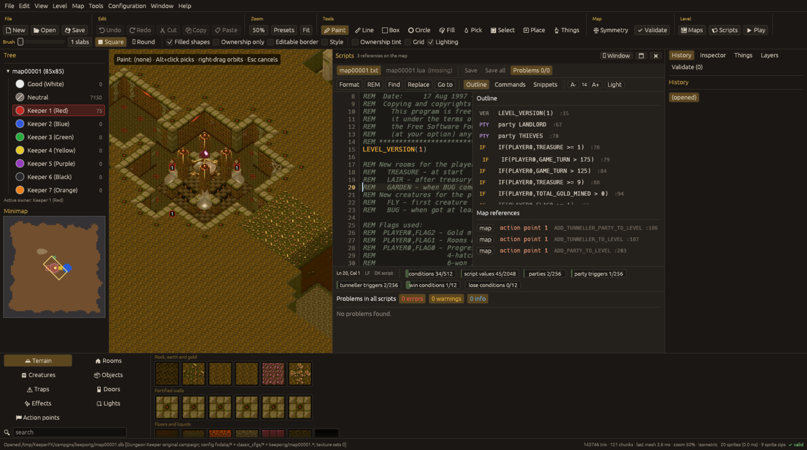

# Scripts: DK script and Lua

A level can have a DK script `mapNNNNN.txt` and a Lua script `mapNNNNN.lua`. Open the script panel
with `Level > Scripts`, the toolbar **Scripts** button or **F3**; F4 maximises it over the map;
it can also be a separate window.

## Panel

* Tabs for the level's `.txt` and `.lua` (and read-only library files). A missing file shows
  "(missing)"; **Create default DK script** / **Create Lua script from template** make one.
* Toolbar: Format, REM (comment), Find, Replace, Go to, Outline, Commands, Snippets, font size.
* Status chips show script limits in use (conditions, script values, parties, party triggers,
  tunneller triggers, win and lose conditions) and the cursor position.
* **Problems** lists diagnostics for all scripts. DK script diagnostics come from the command
  tables extracted from the game source; Lua is parsed and linted against an index of the Lua API
  the game provides.
* Completion (Ctrl+Space), signature help, hover documentation, go to definition (F12), outline
  and references work for both languages. Files are held as Latin-1 so saving does not change
  bytes you did not edit.
* **Map references**: every script line that refers to an action point, hero gate or location is
  listed and drawn as a marker on the map; the `map` button shows it, and clicking a marker jumps
  to the line. Scripts can pick a position from the map for such arguments. When the map's action
  points or hero gates are renumbered you are asked about the script.
* External changes to the files are detected; you can reload or keep your version.

`Ctrl+S` of the main window saves map and scripts. `kfx-editor script-check MAP` runs the same
diagnostics without a window.

### "Not known to this editor build"

The editor knows the script commands, constants, configuration keys and Lua functions of the
KeeperFX revision its data was generated from; Help > About and `kfx-editor --version` show that
revision and its date. A command it does not know is reported as *Unknown command 'NAME': not
known to this editor build's data (generated from KeeperFX \<commit\>, \<date\>); a newer
editor build may know it*. That does not have to mean the game rejects it: KeeperFX gains
commands often, and a game newer than the editor's data may accept commands the editor has not
seen yet. Check the spelling (the message suggests close names), then the
[KeeperFX wiki](https://github.com/dkfans/keeperfx/wiki) or a newer editor build. The reverse
also happens: the editor may know commands that an older KeeperFX release does not have yet.

A command KeeperFX removed is reported as *KeeperFX removed it*; older KeeperFX versions may still
accept it.

Commands added to KeeperFX shortly before the editor's data was generated may only have generic
argument names (`player`, `number2`, ...) and a note instead of a description in the signature
help and the hover; they are valid and checked against the argument types of the command table.

## Script wizard

Level > Script wizard… (or the Wizard… button of the script panel) opens a form for the level's
setup: per player the start gold, creature limit, computer player, which rooms, powers, traps,
doors and creatures are available (No / Research / Yes), the creature pool, alliances, the
portal speed and simple win / lose conditions. The form starts from what the script already
says. Apply writes everything as one block between `REM ---- kfx-editor wizard begin ----` and
`REM ---- kfx-editor wizard end ----` (one undo step in the script editor); nothing outside the
block is changed. Lines elsewhere that set the same things are listed as conflicts; for
commands that add (START_MONEY, ADD_CREATURE_TO_POOL) the block adds the difference. Level >
Lua script wizard… writes the same settings as a marked block of the Lua script.

Level > Open externally opens the DK script, the Lua script or `keeperfx.log` in the system's
program for them.
