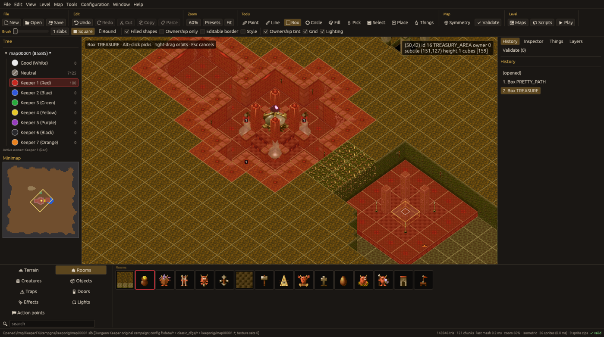

# Terrain tools and ownership

## Palette and owner

The bottom palette's **Terrain** and **Rooms** tabs list slab kinds from the game's `terrain.cfg`
(rock, earth, gold, fortified walls, floors, liquids, bridge, doors; the room tabs list the rooms).
Click a tile to make it the active slab; the search box filters by name. Pick the **owner** in the
left panel: Good (White), Neutral, and Keepers 1 to 7. Alt+click on the map picks the slab *and*
owner under the cursor (the Pick tool does the same).

## Tools

Paint, Line, Box, Circle, Fill (flood fill), Pick, Select; Place and Things are for [things](things.md).
Options in the second toolbar row (also in the Tools menu):

* **Brush** 1 to 9 slabs, square or round;
* **Filled shapes** for Box and Circle;
* **Ownership only**: paint the owner without changing slab kinds;
* **Editable border**: allow editing the outermost ring of slabs (off by default);
* **Style**: paint the per-slab texture style (`.slx`) instead of slabs: 0 is the level default,
  n uses texture set n-1.

Esc cancels the current tool action. The hint line at the top of the viewport names the tool and
slab.

## What an edit does

Edits use the game's own placement rules (a port of the game's `src/map_blocks.c`, see [architecture](../architecture.md)):

* the slab and its neighbours get the right wall, corner and floor columns;
* torches, room furniture, heart pieces and slab lights are replaced for the regenerated slabs;
* liquid (wibble and water/lava type) follows the slab kind;
* things on the slab follow: a room changing owner re-owns or re-creates its contents, doors
  change owner and orientation, placing a non-door slab over a door removes the door;
* optional **decoration** swaps cubes and floor textures for other members of their look-alike
  family (earth, path, gold, gems, bricks, ...) the way shipped maps vary. It is deterministic for
  a given seed; switch it, or single families, off in Preferences > Decoration.

One stroke (press to release) is one undo step. The History tab lists the steps by name
("Box TREASURE"); `Ctrl+Z`, `Ctrl+Y` / `Ctrl+Shift+Z`.

## Selection, clipboard

The Select tool drags a rectangle. Cut, Copy, Paste (Edit menu, toolbar, Ctrl+X/C/V); the clipboard
carries the things, action points and lights on the slabs. While pasting: click stamps, `R`
rotates, `F` flips, Esc stops. `Delete` fills the selection with the palette slab. `Ctrl+A` selects
all.

## Map menu

* **Resize...**: slabs to add (negative removes) at each edge, and a fill slab; things move with
  the map, things cut off are removed.
* **Flip / rotate**: flip east-west or north-south, rotate 90 or 180 degrees, for the whole map or
  the selection; things, action points and lights and door orientations turn with it.
* **Symmetry...**: off, N-S, E-W, 4-way, rotational 2, rotational 4. Painting and placing are
  mirrored; a table sets which owner each sector gets for each owner.
* **Tools > Regenerate all slabs / selection**: recompute columns, decoration, slab objects and
  wibble/liquid, each switchable. It drops hand-made columns and can be undone.

File menu: **Image to map...** turns an image into slabs and owners through an editable colour
table; **Export image...** writes the whole map as a PNG (top-down or isometric).

## Fortify and wall art

Toolbar Options > Fortify: placing a keeper's ground (claimed path, rooms) turns the earth on its
four sides, and the earth beside those, into that keeper's fortified walls. Preferences >
Placement chooses the wall art: Grouped follows the game's own rule (torch walls every fifth
slab, drapes beside claimed ground, then twins / woman / pair bands by the distance from the
keeper's heart) or Random.

## Rounded corners

Preferences > Placement > Rounded corners: a corner subtile of rock, earth, gold, path, water or
lava between two sides of another terrain takes that terrain's column, so blocks look rounded.
Earth and gold next to liquids only round single blocks. It applies to slabs placed or
regenerated afterwards and is decoration only.

## Random doodads

Map > Random doodads… scatters things on chosen slab kinds: for each rule, a slab kind (the
`terrain.cfg` name, e.g. `PATH`, `WATER`, `DIRT` for earth), an object, effect generator or
light, a chance in percent per subtile and an orientation (fixed or random). Apply to the whole
map scatters them as one undo step. They are attached to their slab, so placing or regenerating
a slab scatters its doodads again, with the same result (the scattering is seeded; the seed is in
the dialog). The rules are saved with the map in `mapNNNNN.kfxed.toml`.

## Palette options

Above the slab tiles: the tile size, IDs (the slab ID on each tile) and By ID (one list in ID
order instead of the groups).

## Map options

Map > Ownable natural terrain lets earth, rock, gold and liquids take the painted owner. Map >
Place things anywhere allows things inside walls and rock.
