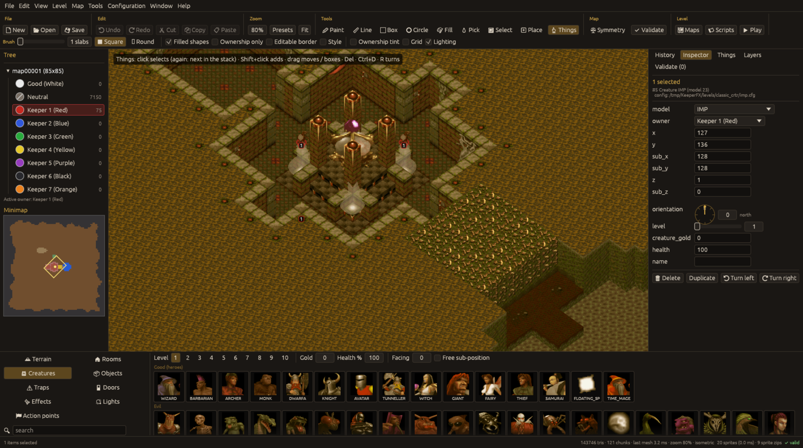

# Things

Things are creatures, objects, traps, doors, effect generators, hero gates (objects), action
points and lights. Pick a tab in the bottom palette (Creatures, Objects, Traps, Doors, Effects,
Lights, Action points) and use the **Place** tool, or the **Things** tool to select and edit.

## Placing

* **Place** puts the palette thing where you click; Shift+click keeps placing.
* The row above the palette holds the defaults for new things (creature level 1 to 10, gold,
  health %, facing, free sub-position; other classes have their own such as lock state or light
  range). Alt+click on a thing copies its settings into the defaults.
* Without free sub-position things snap to the middle of a subtile.
* With symmetry on, placement is mirrored.

## Selecting and editing

* **Things** tool: click selects; click again on the same spot cycles through a stack; Shift+click
  adds; drag moves the selection, or drag on empty ground for a box; `Delete` removes; `Ctrl+D`
  duplicates; `R` / `Shift+R` turn right / left.
* The **Inspector** tab shows the selected thing's fields (model, owner, position and sub-position,
  height, orientation, level, gold, health, name; per class: gold value, hero gate number, custom
  box, effect range, door lock and orientation, parent slab, light range / intensity / dynamic,
  action point number and range) and Delete / Duplicate / Turn buttons.
* The **Things** tab lists everything; selecting centres the view.
* The **Layers** tab and View > Layers hide classes; "slab things" are the torches and furniture
  that belong to slabs.

## Rules taken from the game

* A **door** is a thing plus its door slab; the door model and orientation decide the slab kind, a
  new door's orientation is worked out from the walls around it, a locked door shows a lock and
  gets its key; removing a door turns the slab into claimed path and removes the key.
* **Hero gates** get the smallest free number 1 to 255; **action points** the smallest free number
  from 1 (scripts find them by number).
* Things inside solid rock, doors that cannot stand and similar mistakes are reported by
  [validation](validation.md).
