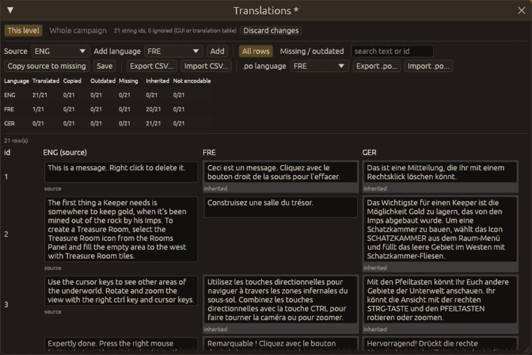

# Translations

The translation grid shows every text the open level uses (the message ids of its DK and Lua
scripts, and its name and description) in every language side by side, so a level can be
translated without editing `.dat` files by hand.

Open it from the Strings window (`Configuration > Strings…`, then **Translations…**). **This level**
shows the level's texts; **Whole campaign** those of every level of its campaign (only for a level
that belongs to a campaign).

## Rows, columns and colours

Each row is a string id, each column a language; the source language (English unless changed in
**Source**) comes first and is what the others are translated from. **Add language** adds a
column. A cell's text is what the game shows for that id in that language; under it:

* *inherited*: the language has no text of its own, the game falls back to a shared text (a GUI
  string with the same index or the game's own file);
* *missing*: nothing at all (red);
* *outdated*: the source text changed after this translation was made (amber);
* *copy*: the source text put there by **Copy source to missing** (blue), until you edit it.

Type in a cell; the text is taken when you leave the cell. Characters the language's code page
cannot store are flagged in the cell and refused. **Missing / outdated** shows only the rows that
need work; the search box finds text or an id. The statistics table counts every state per
language.

## Where texts are written

A text of an id the level's own strings file already has, or a new id, goes to the level file
`mapNNNNN.<lang>.dat`; a text of an id from the campaign's strings goes to the campaign's file of
that language (shared by all its levels). The game's own files in `fxdata/` are never written.
Next to the strings, `mapNNNNN.kfxtexts.toml` (or the campaign's) records which source text each
translation was made from, for the *outdated* state.

**Save** in the grid, the Strings window's save and `File > Save` all write the changed files.
Each file is backed up once per session before it is first overwritten (see
[Saving](getting-started.md#saving)), and written crash-safely. The window title shows `*` while
something is unsaved, and closing the editor asks first.

The Strings window and the grid edit the same files: the grid does not open while the Strings
window has unsaved changes, and the Strings window does not set texts while the grid has unsaved
changes. After one saves, the other reads the files again.

## Exchange with translators

* **Export CSV… / Import CSV…**: one row per text with `scope`, `id`, where it is used, then one
  column per language. On import an empty cell changes nothing.
* **Export .po… / Import .po…**: a gettext file of the language chosen in **.po language**, for
  translation tools such as Poedit; outdated translations are marked fuzzy.

Imported texts appear in the grid as unsaved changes; review them and save.
