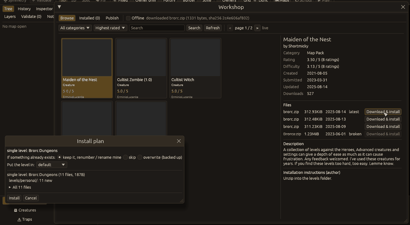

# The KeeperFX Workshop

`Campaign > Workshop…` (**Ctrl+Shift+W**) browses the KeeperFX Workshop
(keeperfx.net), installs items into your KeeperFX folder, removes them again, and packages a
level or campaign for upload.

## Before the first request

The first time, the window only explains what it does: it reads keeperfx.net (item lists, item
pages, pictures and the files you choose to download), with no login, no cookies and no upload.
Nothing is requested until you press "Continue"; the answer is remembered. Tick "Offline" to use
only what is already cached. After that, showing the window loads the first list page; every
other request follows a click. The "Offline" box at the top of the window switches at any time.

Downloaded pages, pictures and files are cached in the `workshop` folder of the platform cache
folder (for example `~/.cache/kfx-editor/workshop` on Linux). The records of what was installed,
with copies of the files an install replaced, are kept in the `workshop` folder of the platform
data folder (for example `~/.local/share/kfx-editor/workshop` on Linux). When
`KFX_EDITOR_CONFIG_DIR` is set, both are kept in that folder instead.

## Browse

Pick a category and a sort order, search by name, and page through the results. Click a card to
see the item: its ratings, dates, pictures, description, the author's install instructions and
its files. "Download & install" fetches a file, looks inside it and shows the install plan.



The plan says where every file goes in the KeeperFX folder set in `Configuration > KeeperFX
folder…`. Choose what happens when something already exists (keep it and renumber / rename the
new one, skip, or overwrite with a backup), and for single levels which map pack gets them.
"Install" applies the plan in one go; the result window has buttons that open the installed
level in the editor or the installed campaign in the [campaign editor](campaigns.md).

## Installed

Everything installed through the Workshop, with "Open level" / "Open campaign", "Uninstall"
(asks first; removes the files and restores what they replaced; files you changed since are
kept and listed) and "Check for updates" (asks keeperfx.net about each item).

## Publish

Package the open level, the open map's campaign or the pack open in the campaign editor into a
zip laid out the way the game and the Workshop expect. "Gather files and run pre-flight" lists
the files (untick one to leave it out) and the problems found: missing map files, private paths,
size, and the editor's own checks of the level (the same as `Level > Validate`) or of the
campaign (the campaign editor's Health tab and every level's map). A level with unsaved changes
is reported: the zip holds the files on disk.

Nothing is uploaded by the editor. After "Write zip", "Copy zip path and open the Workshop upload
page" puts the path on the clipboard and opens the upload page in your browser, where you log in
yourself; "Copy upload form text" copies the title, author and description.

## Command line

The headless mode (`--actions`, see [Command line](cli.md)) never contacts the network: the
Workshop is always offline there.

```json
[
 {"workshop": {"open": true, "acknowledge": true}},
 {"workshop": {"cache": "/path/to/a/workshop/cache", "category": "Map", "tab": "browse"}},
 {"workshop": {"tab": "installed"}},
 {"workshop": {"close": true}}
]
```

`acknowledge` sets whether the first-use notice was read (for a screenshot of the notice use
`false`). `cache` reads an existing cache folder (offline). `tab` is `browse`, `installed` or
`publish`; `category` is a category name as shown in the window.
